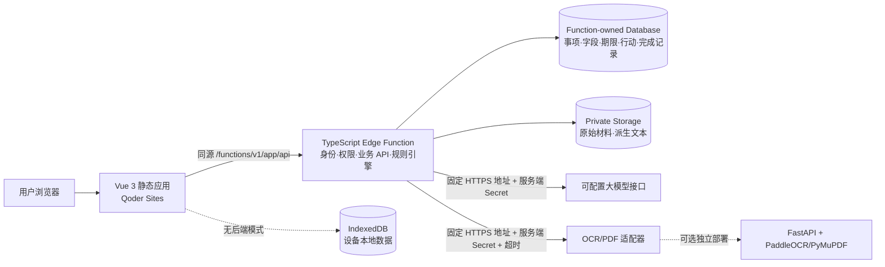
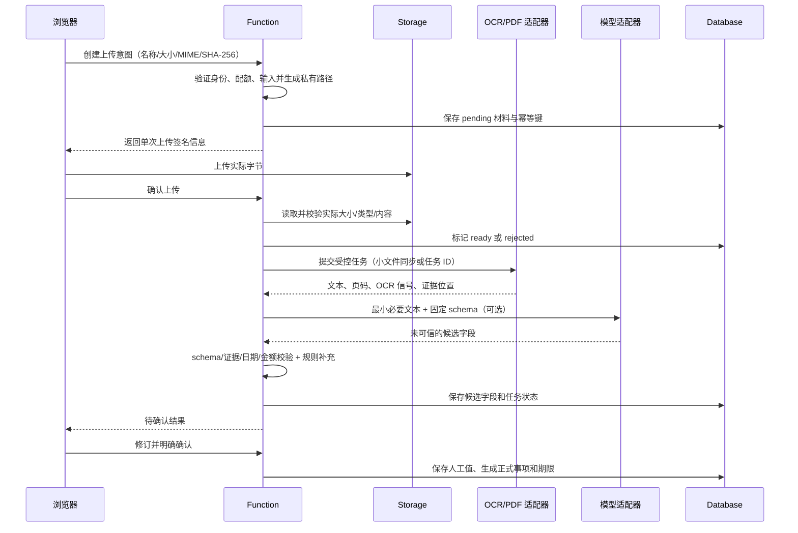

# 知悉 LifeGuard 系统架构与技术选型

## 1. 架构原则

1. **规则拥有事实计算权**：日期、金额、周期、风险、统计和完成状态由确定性代码处理。
2. **AI 只产生候选**：模型不直接写正式事项，不自行确认字段，不修改完成记录。
3. **证据与值分离**：原始材料、候选字段、用户确认值和审计事件分别保存。
4. **服务端拥有权限**：浏览器不能直接访问数据库、私有 Storage、模型或 OCR 凭证。
5. **端口与适配器解耦**：同一业务核心可连接云端、IndexedDB、本地假实现和外部识别服务。
6. **能力失败可见**：任何降级都反映在产品状态中，不用假数据补足失败链路。

## 2. 推荐部署拓扑



### 关键边界

- Qoder Sites 运行静态前端与一个 `app` Edge Function；**不直接运行 FastAPI、Node 常驻服务或 Python OCR 进程**。
- 自托管 OCR 服务是独立可选组件。若未部署，可接其他受控 OCR 接口；两者都不可用时进入真实手工/规则模式。
- 首版不假设 Function 能在响应结束后继续运行。长任务采用外部任务 ID + 有界轮询，或小任务同步完成；不能把浏览器 loading 当作后台任务。
- 首版站内提醒在读取数据时计算。定时邮件、短信和系统推送需独立调度能力，不纳入未验证承诺。

## 3. 技术选型

| 层 | 选择 | 理由与边界 |
| --- | --- | --- |
| 前端框架 | Vue 3、Vite、TypeScript | 符合要求，组件化与类型约束适合多步骤业务闭环 |
| 路由/状态 | Vue Router、Pinia | 路由处理页面；Pinia 管会话与跨视图状态，服务端记录仍以 API 为准 |
| UI | Tailwind CSS + 少量语义化自有组件 | 保持现代 SaaS 视觉，不引入传统后台模板；弹层/菜单注重可访问性 |
| 图表 | ECharts | 趋势与周期支出构成；提供文本摘要，查询失败不画空假图 |
| 前端校验 | Zod 或等价 schema 校验 | 校验 API 边界和表单；服务端必须重复校验 |
| 云业务 API | Qoder Sites TypeScript Edge Function | 同源调用、服务端 Secret、数据库与 Storage 注入；不是 FastAPI 容器 |
| 云数据 | Sites Function-owned Database（Supabase 适配器） | 浏览器无直连，Function 逐条执行 owner 谓词 |
| 云附件 | Sites Storage | 私有路径、上传后字节校验、短时签名下载、逐对象授权 |
| 本地数据 | IndexedDB（可用 Dexie 简化事务和索引） | 保存记录与本地 Blob；localStorage 仅存非敏感 UI 偏好 |
| PDF | 服务端 PyMuPDF（可选 FastAPI 服务）；本地 PDF.js | 文本 PDF 优先文本提取，扫描页才 OCR |
| OCR | PaddleOCR（中文自托管可选）或受控 OCR API | 通过统一适配器输出页码、文本、置信度和可用的位置信息 |
| 信息抽取 | 可配置结构化输出模型 + 规则解析备用 | 模型密钥仅在服务端；输出经 schema、证据和业务校验 |
| 服务端测试 | Deno 检查 + 业务 handler 测试 | 前端 TypeScript 通过不代表 Deno 运行时兼容 |
| 前端测试 | Vitest + Vue Test Utils + Playwright | 规则单测、组件交互和真实浏览器主流程分别验证 |

依赖版本在实施时锁定，并记录 Node/Deno/Python 运行时版本；不在规划阶段虚构最新版本号。

## 4. 模块划分

### 4.1 `web`：交互与展示

- `features/materials`：上传、任务状态、证据预览。
- `features/extraction`：候选字段、冲突提示、用户确认。
- `features/matters`：事项详情、编辑、状态与完成。
- `features/deadlines`：今日队列、时间轴、筛选。
- `features/actions`：模板计划、材料清单、步骤、沟通文本。
- `features/subscriptions`：周期、续费、重复候选、扣款序列。
- `features/insights`：风险总览、趋势、统计下钻。
- `features/demo`：隔离演示工作区，不向生产记录注入样本。
- `shared/api`：同源请求、响应 schema、安全错误映射、请求取消。
- `shared/domain`：纯类型、日期、金额和展示格式化；不含密钥。

UI 组件只发业务命令，不拼接第三方 URL、不决定 owner、不直接修改统计数字。

### 4.2 `functions`：云端业务核心

- `http`：方法、路径、正文大小、Content-Type、响应和错误码。
- `identity`：读取 Qoder 用户上下文；匿名访问仅限明确公开的健康检查。
- `authorization`：每个事项、材料、行动、完成记录和文件的对象级权限。
- `application`：用例编排，如确认抽取、生成计划、完成事项。
- `domain`：规则引擎、日期金额、周期、统计、状态迁移。
- `adapters/database`：固定表名字段、分页、幂等、版本条件更新。
- `adapters/storage`：服务端生成路径、上传验证、短时签名、删除。
- `adapters/ocr`：统一任务/结果接口，隐藏供应商差异。
- `adapters/llm`：结构化候选抽取、受限改写、超时与安全错误。
- `templates`：版本化行动模板，不依赖模型也能运行。

### 4.3 `services/ocr`：可选 Python 服务

- FastAPI 只负责文件预处理、PDF 文本提取、OCR 和标准化结果，不拥有 LifeGuard 业务数据权限。
- 使用固定服务认证、请求大小限制、页数限制、超时、临时文件清理和安全错误码。
- Qoder Function 是调用方；浏览器永远不直接接触该服务或其凭证。
- 外部服务未部署不是本地规则引擎的故障，界面应显示“智能识别未配置”。

## 5. 核心识别管线



### 管线约束

- 文件未通过实际上传校验，不进入识别完成状态。
- 文本型 PDF 与扫描 PDF 分开处理；加密、损坏、超限文件给出具体可恢复错误。
- 模型只能返回候选；找不到证据时值为 `null`，状态为 `pending`。
- 模型不可用时可运行规则解析；规则无匹配就返回待确认，不生成“看似合理”的值。
- 长任务保存 `pending/running/succeeded/failed` 和外部任务 ID；轮询有上限与退避，不做无限请求。
- 外部 OCR 与模型均设超时；未知写入结果先按幂等键对账，不自动重放非幂等操作。

## 6. 候选字段契约示例

```json
{
  "matterType": "purchase",
  "fields": {
    "title": {
      "value": "无线耳机",
      "status": "pending",
      "confidence": 82,
      "confidenceKind": "extractor_score",
      "source": "llm",
      "evidence": { "page": 1, "text": "无线耳机 订单详情", "bbox": null }
    },
    "amount": {
      "value": { "minor": 19900, "currency": "CNY" },
      "status": "pending",
      "confidence": 96,
      "confidenceKind": "rule_match",
      "source": "rule",
      "evidence": { "page": 1, "text": "实付款 ¥199.00", "bbox": null }
    },
    "returnBy": {
      "value": null,
      "status": "pending",
      "confidence": null,
      "confidenceKind": "unavailable",
      "source": "none",
      "evidence": null,
      "reason": "material_not_found"
    }
  },
  "warnings": ["return_policy_required"]
}
```

- `confidence` 是排序/提示信号，不等于真实正确率；不可校准时必须标注类型。
- 用户确认后另存 `confirmed` 或 `corrected` 状态及人工值，原候选不被覆盖。
- API 对成功载荷也做 schema 校验，未知字段和非法值不得进入业务核心。

## 7. 规则引擎

### 7.1 期限与风险

以用户时区的日历日计算 `daysLeft = dueOn - today`。评分仅用于同级排序，公式与规则版本一并保存：

| 因子 | 分值 |
| --- | --- |
| 时间 U：已逾期或今天 / 1–3 天 / 4–7 天 / 8–14 天 / 15–30 天 / 30 天以上 | 60 / 50 / 40 / 30 / 20 / 5 |
| 影响 I：用户确认高 / 中 / 低 | 25 / 15 / 5 |
| 约束 O：材料明确自动续费或合同义务 / 无明确额外约束 | 10 / 0 |
| 行动 A：截止前仍有未完成必需步骤 / 无 | 5 / 0 |

`score = min(100, U + I + O + A)`，映射为低、中、高、紧急。展示时必须同时展示组成原因；金额不直接换算为“损失概率”。已逾期是否仍可处理由事项类型和用户状态决定，不自动声称权益已失效。

### 7.2 潜在损失

- 仅汇总用户确认过 `exposureAmount` 且仍有效的风险项。
- 同一事项多个期限只取当前主风险，订阅续费与事项风险不得重复计数。
- 展示为“可能涉及的金额”，不是确定损失；无金额依据时只显示风险原因。
- 各币种独立汇总，查询失败时显示不可用。

### 7.3 周期与异常

- 每月等值使用有理数/整数策略计算并明确舍入，例如年付金额除以 12；展示保留原始周期。
- 重复订阅先精确标准化名称，再以类别和商家给出候选，均需用户裁定。
- 异常金额与异常间隔至少需同服务三笔实际交易；报告中给出比较基准，不使用 AI 猜测。
- 预计续费支出与实际扣款分开统计。

### 7.4 行动模板

模板键由 `matterType + goal + templateVersion` 决定，内容包含步骤、材料、沟通文本和注意事项。模型只能在限定字段中改写，不得改变确认日期、金额、步骤完成状态或外部链接。外部入口只使用用户确认或平台配置的固定可信地址。

## 8. API 边界（逻辑路由）

所有云业务请求使用同源 `/functions/v1/app/api` 前缀；实际路由在部署后验证，不依赖物理 Function 名称。

| 方法与路径 | 用途 | 关键保护 |
| --- | --- | --- |
| `POST /materials/upload-intents` | 创建上传意图 | 登录、大小/MIME、幂等键、私有路径 |
| `POST /materials/{id}/complete` | 校验已上传对象 | owner、实际字节、状态迁移 |
| `POST /materials/{id}/extractions` | 创建识别任务 | owner、能力配置、重复任务控制 |
| `GET /extractions/{id}` | 查询识别状态 | owner、有界轮询 |
| `PUT /extractions/{id}/confirmation` | 修订并确认 | 版本、字段白名单、业务校验 |
| `GET /matters` / `POST /matters` | 列表/手工新建 | owner、分页、幂等 |
| `GET/PATCH /matters/{id}` | 详情/编辑 | owner、版本条件更新 |
| `GET /radar?days=30` | 今日和近期雷达 | owner、时区、统一规则 |
| `POST /matters/{id}/action-plan` | 生成/刷新行动计划 | owner、模板版本、AI 可选 |
| `PATCH /action-steps/{id}` | 勾选步骤 | owner、版本 |
| `POST /matters/{id}/completion` | 记录结果 | owner、金额校验、幂等 |
| `GET /subscriptions` | 周期与续费 | owner、真实记录 |
| `POST /payments` | 添加实际扣款 | owner、重复交易检查 |
| `GET /insights?range=...` | 真实统计 | owner、币种分组、可下钻 |
| `GET/DELETE /materials/{id}` | 授权下载/删除 | owner、短时签名、一致性处理 |
| `GET /capabilities` | 返回真实能力状态 | 不泄露供应商地址和密钥 |

写操作不接受浏览器提供的 `ownerId`；未知路径返回 404，不支持方法返回 405，GET 不产生业务写入。

## 9. 安全与隐私设计

- 使用 Qoder 注入的用户上下文，并验证 Gateway-only 入口及 Provider 直连防护；未完成真实隔离验收前只能声明限定测试范围。
- 数据库采用 Function-owned 私有访问模型，Function 每个查询带 owner 条件；浏览器没有数据库密钥。
- Storage 对象路径由服务端生成，可从服务端用户 ID 派生不可逆目录段；现有对象另查 owner，路径本身不是权限证明。
- 上传后验证字节、MIME 与文件内容；签名 URL 不进日志、分析事件或源码。
- 第三方模型/OCR 地址为服务端固定配置，不能由浏览器传任意 URL，避免带凭证 SSRF。
- 仅发送抽取所需最小文本；返回给前端的错误为稳定业务码，不含上游响应、SQL、内部路由和 Secret。
- 真实上传材料不进入 `dist/`、演示 fixture、GitHub 示例或公开 Storage。
- 日志只保留请求 ID、阶段、安全错误码和必要耗时；不记录私人正文。

## 10. 降级与能力矩阵

| 能力 | 云版已配置 | 云版未配置 AI/OCR | 纯静态本地版 |
| --- | --- | --- | --- |
| 手工事项、确认、期限、行动、完成 | 完整 | 完整 | 完整，数据仅本机 |
| 私有云附件 | Storage 可用 | Storage 可用时完整 | IndexedDB Blob，受浏览器配额影响 |
| PDF 文本提取 | 真实服务结果 | 未配置则明确不可用或本地处理 | PDF.js 真实处理 |
| 图片 OCR | 真实 OCR 结果 | 标记未配置，可手工录入 | 仅实际集成并运行成功才可用 |
| 大模型候选抽取 | 服务端调用 | 规则备用，明确未配置 | 无服务端密钥，不伪造；仅规则 |
| 跨设备同步 | 同一账户云端记录 | 可用 | 不支持 |
| 后台通知 | 未接调度则不支持 | 不支持 | 不支持，仅站内提醒 |
| 统计 | 云端实际记录 | 云端实际记录 | 本地实际记录 |

## 11. 架构验收门槛

- 从浏览器到数据库/Storage/模型的路径均经过服务端授权，构建产物无秘密。
- 用同一业务核心分别通过云端适配器与本地适配器跑通闭环。
- 关闭模型与 OCR 后，手工和规则闭环无需修改 UI 数据口径。
- 同一字段从候选到人工修订有完整来源，不覆盖原证据。
- 识别失败、上传丢失响应、编辑冲突和删除部分失败均有可恢复状态。
- 部署后分别验证真实账户隔离、对象下载权限和第三方调用，不能用本地 fixture 替代这些结论。
