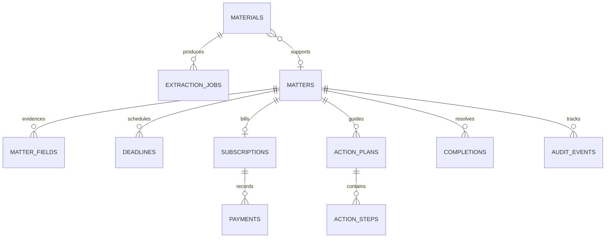

# 知悉 LifeGuard 数据结构与统计口径

## 1. 设计约束

- 云端采用 Qoder Sites Function-owned Database，逻辑 schema 为 `app`；所有业务行包含 `owner_id`，由 Function 从可信身份写入。
- 当前 Sites 迁移接口支持 `boolean/integer/bigint/text/uuid/timestamptz/jsonb` 等受限类型。日历日期使用经严格校验的 `text YYYY-MM-DD`，金额使用 `bigint` 最小货币单位，标签/证据使用有界 `jsonb`。
- 不依赖迁移接口尚不支持的 `date/numeric`、CHECK、触发器、自定义函数或表达式索引。字段关系、日期、金额、JSON 形状和数组长度由 Function 校验。
- 数据库固定私有策略不是完整应用授权：每次读写仍需带 `owner_id` 与对象权限条件。
- 所有表包含 `id uuid`、`created_at timestamptz`；可编辑业务表包含 `version integer`，从 1 开始。

## 2. 实体关系

首版一份材料主要关联一个事项；多对多材料合并作为 P1。若提前出现需求，使用显式关联表，不在 `matters` 中塞材料 ID 数组。

## 3. 云端表设计

### 3.1 `app.profiles`：用户设置

| 字段 | 类型 | 说明 |
| --- | --- | --- |
| `user_id` | text PK | Qoder 服务端用户 ID，不采用浏览器提交值 |
| `timezone` | text | 默认 `Asia/Shanghai`，仅允许有效 IANA 时区 |
| `locale` | text | 默认 `zh-CN` |
| `default_currency` | text | ISO 4217 三位代码，默认 `CNY` |
| `created_at` / `updated_at` | timestamptz | 时间戳 |
| `version` | integer | 乐观锁 |

不保存模型 API Key、OCR 密钥或数据库连接信息。

### 3.2 `app.materials`：原始材料

| 字段 | 类型 | 约束/含义 |
| --- | --- | --- |
| `id` | uuid PK | 服务端生成 |
| `owner_id` | text NOT NULL | 所有者 |
| `original_name` | text NOT NULL | 有界长度，仅显示用，不作为存储路径 |
| `media_type` | text NOT NULL | 校验后的 MIME |
| `size_bytes` | bigint | 上传校验后的真实字节数，pending 时可空 |
| `sha256` | text | 64 位小写十六进制，用于完全相同文件提示 |
| `storage_path` | text UNIQUE | 服务端生成的 bucket 相对私有路径 |
| `page_count` | integer | PDF 实际页数，可空 |
| `status` | text | `pending_upload/uploaded/processing/ready/rejected/deleted` |
| `failure_code` | text | 稳定安全错误码，不存原始上游异常 |
| `idempotency_key` | text | 与 owner、操作和载荷指纹共同防重 |
| `created_at` / `updated_at` | timestamptz | 时间戳 |

`extracted_text` 不直接放公开日志。若必须持久化，放私有 Storage 的派生对象并在 `extraction_jobs` 保存路径；数据库只保留必要片段。

### 3.3 `app.extraction_jobs`：识别批次

| 字段 | 类型 | 说明 |
| --- | --- | --- |
| `id` / `owner_id` / `material_id` | uuid/text/uuid | 主键、所有者、材料 |
| `status` | text | `queued/running/waiting_confirmation/succeeded/failed/cancelled` |
| `pipeline` | text | `pdf_text_ocr_llm/pdf_text_rule/ocr_rule/manual` 等实际管线 |
| `provider_job_id` | text | 外部异步任务 ID，可空；不暴露凭证 |
| `matter_type_candidate` | text | 候选事项类型，可空 |
| `warnings` | jsonb | 有界安全警告代码数组 |
| `error_code` | text | 如 `ocr_not_configured/timeout/invalid_pdf` |
| `rule_version` | text | 规则版本 |
| `model_name` | text | 实际模型标识，可空；不记录密钥 |
| `idempotency_key` | text | 防重复识别任务 |
| `started_at` / `finished_at` | timestamptz | 实际阶段时间 |
| `created_at` / `updated_at` / `version` | 对应类型 | 审计与并发控制 |

“成功”表示识别流程完成，不表示字段已确认。`waiting_confirmation` 可以包含空候选。

### 3.4 `app.matters`：生活事项

| 字段 | 类型 | 说明 |
| --- | --- | --- |
| `id` / `owner_id` | uuid/text | 主键与所有者 |
| `primary_material_id` | uuid | 主要来源材料，可空 |
| `matter_type` | text | `purchase/warranty/subscription/lease/course/payment/other` |
| `title` | text | 用户可编辑，有界长度 |
| `merchant` | text | 标准化前保留原文 |
| `merchant_key` | text | 服务端标准化匹配键，可空 |
| `order_reference_masked` | text | 默认脱敏订单标识，可空 |
| `amount_minor` | bigint | 事项金额，可空 |
| `currency` | text | 有金额时必填 |
| `purchased_on` | text | `YYYY-MM-DD`，可空 |
| `start_on` / `end_on` | text | 合同/课程/保修等区间，可空 |
| `impact_level` | text | `low/medium/high`，默认中，用户可改 |
| `exposure_amount_minor` | bigint | 用户确认的潜在涉及金额，可空 |
| `status` | text | `draft/pending_confirmation/active/completed/dismissed` |
| `dismissal_reason` | text | 忽略原因，可空 |
| `confirmed_at` | timestamptz | 用户确认时间，可空 |
| `created_at` / `updated_at` / `version` | 对应类型 | 审计与并发控制 |

金额是否等于潜在损失不作默认推断；`exposure_amount_minor` 必须独立确认并保留依据。

### 3.5 `app.matter_fields`：字段证据与确认

| 字段 | 类型 | 说明 |
| --- | --- | --- |
| `id` / `owner_id` / `matter_id` | uuid/text/uuid | 关联事项 |
| `extraction_job_id` | uuid | 来源批次，可空（手工事项） |
| `field_key` | text | 白名单，如 `title/amount/returnBy/renewalOn` |
| `candidate_json` | jsonb | 原始候选，值与形状有界，可空 |
| `confirmed_json` | jsonb | 用户确认值，可空 |
| `field_status` | text | `pending/confirmed/corrected/rejected` |
| `source` | text | `ocr/llm/rule/manual/none` |
| `confidence` | integer | 0–100，可空；不是准确率 |
| `confidence_kind` | text | `ocr_signal/extractor_score/rule_match/unavailable` |
| `evidence_json` | jsonb | `{page,text,bbox?}`，文本长度受限 |
| `reason_code` | text | 缺失/冲突原因，可空 |
| `confirmed_at` | timestamptz | 用户确认时间 |
| `created_at` / `updated_at` / `version` | 对应类型 | 审计与并发控制 |

逻辑唯一性为 `(matter_id, field_key, extraction_job_id)`；实施时使用迁移接口实际支持的约束或由 Function 幂等控制。正式业务读取确认值，候选值仅用于对照。

### 3.6 `app.deadlines`：已确认期限

| 字段 | 类型 | 说明 |
| --- | --- | --- |
| `id` / `owner_id` / `matter_id` | uuid/text/uuid | 关联事项 |
| `deadline_type` | text | `return/warranty/renewal/cancel_notice/lease_end/course_end/payment/custom` |
| `due_on` | text | 已校验 `YYYY-MM-DD` |
| `lead_days` | integer | 用户希望提前多少天进入关注，0–3650 |
| `status` | text | `active/completed/dismissed` |
| `source` | text | `material/manual/derived` |
| `derivation_json` | jsonb | 来源日期、规则、周期、单位和版本；手工时为空 |
| `confirmed_at` | timestamptz | 必填，确认后才创建正式期限 |
| `created_at` / `updated_at` / `version` | 对应类型 | 审计与并发控制 |

同一事项的同一类型可有历史期限，但只允许一个当前主期限；由状态和 Function 业务校验保证。修改截止日创建审计事件。

### 3.7 `app.subscriptions`：周期消费

| 字段 | 类型 | 说明 |
| --- | --- | --- |
| `id` / `owner_id` / `matter_id` | uuid/text/uuid | 一个订阅对应一个事项 |
| `service_name` / `service_key` | text | 原始名和标准化键 |
| `category` | text | 用户确认的类别 |
| `amount_minor` / `currency` | bigint/text | 每周期价格与币种 |
| `interval_unit` | text | `day/week/month/year` |
| `interval_count` | integer | 正整数，有合理上限 |
| `started_on` | text | 可空 |
| `next_renewal_on` | text | 用户确认后填写，可空 |
| `auto_renew` | boolean | 只有明确依据才设为 true，否则可空 |
| `status` | text | `active/paused/cancelled/unknown` |
| `duplicate_group_key` | text | 精确标准化匹配组，可空 |
| `duplicate_state` | text | `none/candidate/confirmed_duplicate/distinct/unsure` |
| `created_at` / `updated_at` / `version` | 对应类型 | 审计与并发控制 |

`auto_renew` 可空以区分“明确不自动续费”和“不知道”。

### 3.8 `app.payments`：实际扣款记录

| 字段 | 类型 | 说明 |
| --- | --- | --- |
| `id` / `owner_id` / `subscription_id` | uuid/text/uuid | 关联订阅 |
| `material_id` | uuid | 来源材料，可空 |
| `paid_on` | text | 实际扣款日 |
| `amount_minor` / `currency` | bigint/text | 实际金额和币种 |
| `external_reference_hash` | text | 可选交易引用哈希，不保存完整敏感标识 |
| `idempotency_key` | text | 防重复导入 |
| `created_at` / `updated_at` / `version` | 对应类型 | 审计与并发控制 |

预测续费不写入 `payments`，避免把估算当真实支出。

### 3.9 `app.action_plans` 与 `app.action_steps`

`action_plans`：

| 字段 | 类型 | 说明 |
| --- | --- | --- |
| `id` / `owner_id` / `matter_id` | uuid/text/uuid | 关联事项 |
| `template_key` / `template_version` | text | 可追溯模板 |
| `generation_mode` | text | `rule/llm_assisted`，禁止把规则结果标成 AI |
| `goal` | text | `return/warranty/cancel_subscription/move_out/...` |
| `checklist_json` | jsonb | 有界材料清单 |
| `communication_text` | text | 可编辑沟通模板 |
| `warnings` | jsonb | 信息缺口与免责声明代码 |
| `created_at` / `updated_at` / `version` | 对应类型 | 审计与并发控制 |

`action_steps`：

| 字段 | 类型 | 说明 |
| --- | --- | --- |
| `id` / `owner_id` / `plan_id` | uuid/text/uuid | 关联计划 |
| `position` | integer | 稳定顺序 |
| `title` / `detail` | text | 可执行步骤 |
| `required` | boolean | 是否主流程必需 |
| `status` | text | `pending/completed` |
| `completed_at` | timestamptz | 可空 |
| `created_at` / `updated_at` / `version` | 对应类型 | 审计与并发控制 |

模板刷新不得默认清空用户已完成步骤；需要按稳定步骤键迁移或另存新计划并保留旧计划。

### 3.10 `app.completions`：完成结果与真实节省

| 字段 | 类型 | 说明 |
| --- | --- | --- |
| `id` / `owner_id` / `matter_id` | uuid/text/uuid | 关联事项 |
| `outcome` | text | `refunded/returned/repaired/cancelled/moved_out/paid/other` |
| `completed_on` | text | 用户确认完成日 |
| `saved_amount_minor` | bigint | 用户确认节省额，可空；0 与 null 含义不同 |
| `currency` | text | 有节省金额时必填 |
| `savings_basis` | text | 如 `actual_refund/avoided_renewal/user_estimate` |
| `note` | text | 有界备注 |
| `idempotency_key` | text | 防重复完成 |
| `created_at` / `updated_at` / `version` | 对应类型 | 审计与并发控制 |

`user_estimate` 必须与 `actual_refund` 等分开显示；前端统一标“用户确认/记录”，不得称平台核算收益。

### 3.11 `app.audit_events`：重要变更

| 字段 | 类型 | 说明 |
| --- | --- | --- |
| `id` / `owner_id` / `matter_id` | uuid/text/uuid | 关联事项 |
| `event_type` | text | 确认、修订、状态变化、完成、恢复等 |
| `entity_type` / `entity_id` | text/text | 被修改对象 |
| `summary_json` | jsonb | 字段键、旧新状态等最小必要信息 |
| `created_at` | timestamptz | 事件时间 |

不记录原始文件、完整 OCR 文本、密钥、签名 URL 或无关敏感正文。

## 4. 关键不变量

1. 有 `amount_minor` 就必须有合法 `currency`；反之空金额不得伪造币种金额 0。
2. 金额必须为非负安全整数，小数位符合币种；退款方向由 `outcome`/记录类型表达。
3. `due_on/purchased_on/start_on/end_on/paid_on/completed_on` 必须是真实日历日期。
4. 有起止日期时 `start_on <= end_on`；衍生日期必须有 `derivation_json`。
5. 正式 `deadlines` 只能来自确认字段或手工确认表单，必须有 `confirmed_at`。
6. 候选字段不进入正式风险与统计；人工修订不覆盖候选和证据。
7. 不同币种不直接求和；金额展示明确舍入规则。
8. `completed` 事项至少有一条完成记录；恢复事项不删除历史完成记录，但当前状态重新激活。
9. 预测续费与实际 `payments` 分离；异常检测至少三笔同服务同币种实际交易。
10. 每条记录每次读写都带 owner 条件，删除/下载还需对象状态与权限验证。
11. 所有创建命令有幂等键；所有可编辑记录用版本条件更新，影响行数为 0 时不宣称成功。
12. 演示记录不进入上述生产表；独立本地命名空间或独立演示账户，禁止 `is_demo=true` 后意外混算。

## 5. 索引与查询规划

以下都是普通列索引，适配 Sites 受限迁移能力；最终名称和 DDL 以实际 migration 校验为准。

| 查询 | 建议索引/谓词 |
| --- | --- |
| 今日与 30 天雷达 | `deadlines(owner_id, due_on)` 若复合索引受限则分别建 `owner_id`、`due_on`，Function 同时过滤 owner/status |
| 事项列表 | `matters(owner_id)`、`matters(updated_at)`；有界游标/分页 |
| 材料重复提示 | `materials(owner_id)`、`materials(sha256)`；查询同时带两者 |
| 材料状态恢复 | `materials(status)`，仅用于 owner 过滤后的有界任务查询 |
| 字段证据 | `matter_fields(matter_id)`，同时带 owner |
| 订阅续费 | `subscriptions(next_renewal_on)`、`subscriptions(owner_id)` |
| 扣款序列 | `payments(subscription_id)`、`payments(paid_on)`，按稳定日期和 ID 排序 |
| 行动步骤 | `action_steps(plan_id)`，按 `position` 排序 |
| 历史完成 | `completions(owner_id)`、`completions(completed_on)` |
| 审计时间线 | `audit_events(matter_id)`、`audit_events(created_at)` |

普通索引不能替代授权。统计使用有界 owner 数据集和精确 count；查询失败不能返回 0 伪装成功。

## 6. 统计计算口径

| 指标 | 来源与过滤 |
| --- | --- |
| 待处理数 | `matters.status=active` 且存在活跃期限或未完成的必需步骤 |
| 近期到期数 | `deadlines.status=active`、`confirmed_at` 非空，`due_on` 在用户时区窗口内 |
| 风险项 | 对活跃事项执行当前规则版本，保留原因与计算日期 |
| 潜在涉及金额 | 当前主风险的 `exposure_amount_minor`，按币种求和并去除同事项重复期限 |
| 完成数 | `completions` 记录或按事项去重，页面明确显示“事项数/结果记录数” |
| 用户确认节省 | `completions.saved_amount_minor` 按币种和 `savings_basis` 分组求和 |
| 周期每月等值 | 活跃订阅按周期折算，和实际扣款分开；显示舍入后的展示值 |
| 即将续费 | 活跃且 `auto_renew=true`、确认过的 `next_renewal_on` 位于窗口内 |
| 风险趋势 | 每日/每周按当时期限快照；若无历史快照，只展示“当前期限分布”和“完成趋势”，不得倒造历史风险 |
| 完成趋势 | `completions.completed_on` 按周/月聚合 |

**重要限制**：只保存当前事项无法还原过去任意一天的真实风险。若需要“历史风险趋势”，从 P0 开始保存每日首次访问时的轻量 `risk_snapshots`（owner、snapshot_on、counts_json、exposure_json、rule_version）；没有快照的日期显示空白，不回填虚构数据。

## 7. 本地 IndexedDB 镜像

建议数据库 `lifeguard-local`，版本化 object stores：

| Store | 主键/索引 | 内容 |
| --- | --- | --- |
| `matters` | `id`；`status,updatedAt` | 与云事项同构，owner 固定为本地命名空间 |
| `materials` | `id`；`sha256,status` | 元数据，私有 Blob 放 `blobs` |
| `blobs` | `id` | 原始文件/派生文本 Blob，不进入导出的公开资源目录 |
| `extractionJobs` | `id`；`materialId,status` | 真实本地处理状态 |
| `fields` | `id`；`matterId` | 候选、证据与确认值 |
| `deadlines` | `id`；`matterId,dueOn` | 已确认期限 |
| `subscriptions` / `payments` | `id`；关联键与日期 | 周期和实际扣款 |
| `actionPlans` / `actionSteps` | `id`；关联键 | 行动计划与步骤 |
| `completions` / `auditEvents` | `id`；关联键与日期 | 结果与历史 |
| `settings` | `key` | 时区、币种、schema 版本；不存任何模型密钥 |
| `riskSnapshots` | `id`；`snapshotOn` | 真实访问时生成的快照 |

- 多表写使用 IndexedDB transaction；云端不能用多次 SDK 调用假装事务。
- 本地数据结构复用领域 schema，但 ID、owner 与同步状态独立，不在首版承诺云同步。
- 导出 JSON 包含 schema 版本和记录，可选择是否包含附件；导入先校验、预览重复项，再确认写入。
- 清空数据需明确确认；提示浏览器站点数据被清理、隐私模式或配额不足可能造成丢失。
- 演示使用另一个数据库 `lifeguard-demo`，生产查询绝不跨库。

## 8. 文件与数据生命周期

### 文件路径

- 路径由服务端生成，例如 `user-hash/material-uuid/original`，不含用户原始文件名和浏览器 owner。
- 派生文本放独立私有路径；签名下载 URL 有效期取满足预览的最小值。
- `pending_upload` 长时间未完成和 `rejected` 文件需有清理策略；清理任务未实现前显示状态并允许用户重试/删除，不宣称自动清理。

### 删除

1. Function 验证 owner 和对象状态。
2. 先标记 `deleting`（如采用该状态）并阻止新任务。
3. 删除私有对象与数据库关联；任一步失败保留可诊断状态并允许恢复/重试。
4. 多步操作不宣称原子；界面只有在必要对象均确认删除后显示“已彻底删除”。

### 留存

首版由用户主动删除。若未来设置自动留存期限，必须有真实调度与可验证删除记录，不能靠前端定时器保证。
