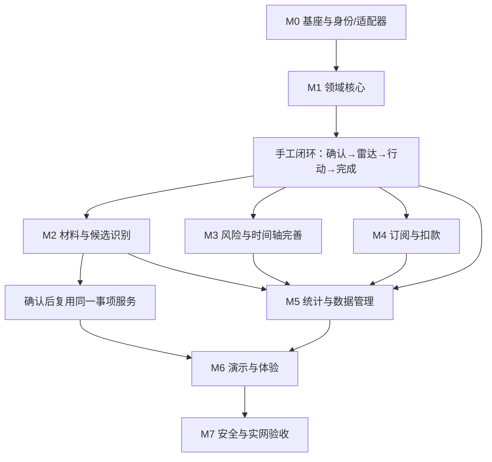

# 知悉 LifeGuard 开发顺序与项目目录

## 1. 实施策略

采用“**先手工闭环，再智能识别；先规则真实，再 AI 增强；先单用户权限，再演示打磨**”的顺序。这样即使 OCR 或模型服务暂时不可用，也能交付完整、真实、可演示的产品，而不是先完成一个漂亮上传页再补业务。

每个阶段必须保持可构建、可测试，禁止同时铺开五个模块后集中补逻辑。

## 2. 阶段规划

### M0：架构验证与项目基座（架构确认后第一步）

**内容**

- 初始化 Vue 3/Vite/TypeScript、Tailwind、Router、Pinia、Vitest。
- 建立领域类型、API 错误契约、响应 schema、时间/金额测试工具。
- 验证最小 Sites Function、本地代理、Deno 检查和静态构建。
- 用最小私有记录与附件验证 Function-owned Database/Storage 路径；云操作需用户另行授权。
- 确认 OCR/模型供应商、超时和异步任务契约；未配置则记录真实降级。

**完成标准**：手工健康记录可经真实 handler 读写，前端不持有秘密；未验证项明确列出。

### M1：领域核心与手工业务闭环

**内容**

- 实现日期、金额、事项状态、期限、风险、统计的纯函数。
- 手工新建/编辑/确认事项，生成期限。
- 首页今日队列、30 天时间轴、事项详情。
- 版本化规则行动模板、步骤勾选、完成记录。
- IndexedDB 或云端第一条纵向数据路径，刷新后仍在。
- 空数据、非法输入、重复提交、编辑冲突。

**完成标准**：不调用 AI，也能完成“新建 → 确认 → 雷达 → 行动 → 完成 → 真实统计”。

### M2：智能材料识别与确认

**内容**

- 私有上传意图、实际字节校验、SHA-256 重复提示、材料状态。
- PDF 文本/OCR 适配器与外部任务轮询；规则解析备用。
- 模型结构化候选抽取、证据与字段级可信状态。
- 原图/PDF 与字段对照、待确认、冲突、人工修订。
- 确认后复用 M1 的事项与期限服务。
- 上传响应丢失、识别失败、部分字段成功、重试和删除。

**完成标准**：真实图片/PDF 能走通配置过的管线；未配置时明确降级，任何缺失字段都不会被编造。

### M3：期限雷达与风险解释完善

**内容**

- 完成六类事项模板与筛选、排序、详情抽屉。
- 潜在涉及金额去重、风险原因和规则版本。
- 当前期限分布、真实访问风险快照。
- 时区、逾期、今天、跨月、闰年和无金额场景。

**完成标准**：所有风险可解释并可下钻到记录；查询失败不显示为 0。

### M4：隐形消费与订阅

**内容**

- 订阅手工/识别确认、周期与下次续费。
- 每月等值、即将续费、重复候选和用户裁定。
- 实际扣款记录、重复交易检测。
- 至少三笔交易后的金额/间隔异常分析。

**完成标准**：预测和实际严格分离；不同币种不混算；没有足够数据时不报异常。

### M5：风险总览、历史与数据管理

**内容**

- 待处理、近期、风险、完成、用户确认节省和趋势。
- 每个统计下钻到来源记录，区分实际/估算节省。
- JSON 导出、附件导出选项、删除和数据清理。
- 审计时间线、恢复事项、版本冲突处理。

**完成标准**：增删改、完成和恢复后统计一致；趋势无快照日期保持空白。

### M6：演示体验与视觉/可访问性

**内容**

- 独立演示数据库/命名空间、动态相对日期、重置和退出。
- 首页“清晰的生活控制塔”视觉、响应式和键盘交互。
- 加载/空/错/部分成功状态、ECharts 文本摘要。
- 评委 3 分钟主路径和识别样例的明确标注。

**完成标准**：桌面与移动端真实操作通过，演示不影响真实记录，无装饰性假按钮。

### M7：安全、部署与竞赛验收

**内容**

- 双账号对象级权限、Provider 入口、Secret、日志和公开内容检查。
- 生产构建、SPA 深链、Function/Database/Storage 实网验收。
- OCR/模型故障、超时、服务未配置、限流与恢复。
- 性能、包体积、浏览器兼容和测试证据归档。

**完成标准**：Go/No-Go 清单全部有实测证据；未配置能力显著说明，不用预览代替动态测试。

## 3. 模块依赖关系



M2 不应另建“识别专用统计”，M4 不应另建“订阅专用提醒”；它们必须复用同一确认事项、期限与统计核心。

## 4. 推荐目录结构

```text
E:/CODE/create/
├─ docs/                              # 本轮规划文档
│  ├─ 00-planning-overview.md
│  ├─ 01-product-prd.md
│  ├─ 02-architecture.md
│  ├─ 03-data-model.md
│  ├─ 04-roadmap-and-structure.md
│  ├─ 05-qoder-sites-deployment.md
│  ├─ 06-test-plan.md
│  └─ 07-github-research.md
├─ apps/
│  ├─ web/                            # Vue 3 + Vite + TypeScript
│  │  ├─ public/                      # 仅公开静态资源，禁止私人材料/Secret
│  │  ├─ src/
│  │  │  ├─ app/                      # 启动、路由、全局布局、能力状态
│  │  │  ├─ components/               # 通用可访问 UI  primitives
│  │  │  ├─ features/
│  │  │  │  ├─ materials/             # 上传与材料状态
│  │  │  │  ├─ extraction/            # 候选字段与人工确认
│  │  │  │  ├─ matters/               # 事项编辑、详情与完成
│  │  │  │  ├─ deadlines/             # 今日队列与时间轴
│  │  │  │  ├─ actions/               # 行动计划与步骤
│  │  │  │  ├─ subscriptions/         # 周期、扣款、重复候选
│  │  │  │  ├─ insights/              # 风险总览与趋势
│  │  │  │  ├─ demo/                  # 独立演示入口，不放生产 fixture
│  │  │  │  └─ settings/              # 时区、数据与隐私
│  │  │  ├─ shared/
│  │  │  │  ├─ api/                   # 同源请求与响应校验
│  │  │  │  ├─ charts/                # ECharts 按需封装与文本摘要
│  │  │  │  ├─ local/                 # IndexedDB 适配器
│  │  │  │  └─ ui/                    # 格式化、样式与反馈
│  │  │  ├─ styles/
│  │  │  ├─ App.vue
│  │  │  └─ main.ts
│  │  ├─ tests/                       # 组件与前端集成测试
│  │  ├─ index.html
│  │  └─ vite.config.ts               # 本地 /functions 同源代理
│  └─ function/                       # Function 业务源码（非直接发布目录）
│     ├─ http/                        # 路由、方法、正文、错误映射
│     ├─ identity/                    # 用户上下文与登录要求
│     ├─ application/                 # 用例编排与幂等恢复
│     ├─ authorization/               # 对象级 owner 校验
│     ├─ adapters/
│     │  ├─ database/
│     │  ├─ storage/
│     │  ├─ ocr/
│     │  └─ llm/
│     ├─ templates/                   # 版本化行动模板
│     └─ tests/
├─ packages/
│  ├─ domain/                         # 纯 TS：日期、金额、风险、周期、统计、状态
│  │  ├─ src/
│  │  └─ tests/
│  └─ contracts/                      # API DTO、schema、稳定错误码
│     ├─ src/
│     └─ tests/
├─ services/
│  └─ ocr/                            # 可选、独立部署，不打入 Sites Function
│     ├─ app/
│     │  ├─ api/                      # FastAPI 路由与认证
│     │  ├─ pdf/                      # PyMuPDF 文本/页面处理
│     │  ├─ ocr/                      # PaddleOCR 适配
│     │  └─ schemas/                  # 标准化 OCR 结果
│     ├─ tests/
│     ├─ pyproject.toml
│     └─ Dockerfile                   # 仅外部部署需要
├─ database/
│  └─ migrations/                     # 经审查的受限 SQL；由 Sites 工具应用
├─ dev/                               # 无凭证假适配器、本地 runner、测试身份
│  └─ fixtures/                       # 明确虚构样例，禁止真实材料与 Secret
├─ tests/
│  ├─ e2e/                            # Playwright 主流程与移动端
│  ├─ contract/                       # 前后端/第三方契约
│  └─ recognition/                    # 获授权的匿名化识别评测集
├─ scripts/                           # 构建、打包、密钥/产物扫描等
├─ functions/                         # 构建生成的自包含 Sites Function 包
│  └─ index.ts                        # Deno 入口；不含 _qoder、dev、Secret
├─ .env.example                       # 仅非敏感变量名示例，不填真实 Key
├─ .gitignore
├─ package.json                       # workspaces 与统一脚本
├─ tsconfig.base.json
└─ README.md                          # 实施阶段创建：运行、能力边界和测试命令
```

### 目录约束

- `apps/web/dist` 是唯一 Web 发布目录，`functions` 是唯一 Function 发布目录；两者由构建生成。
- `packages/domain` 与 `packages/contracts` 在构建时打包进对应产物，不能依赖 Sites 运行时解析 workspace/path alias。
- `dev`、`services/ocr`、测试材料、数据库迁移和 `docs` 不进入发布包。
- 不在任何目录手建 `functions/_qoder`；平台在部署时注入受支持 SDK。
- 演示 fixture 使用虚构数据且与真实存储隔离；真实私人材料不入库、不进 Git。

## 5. 每阶段统一 Definition of Done

- 类型检查、相关单测和构建通过；Function 另做 Deno 检查。
- 主路径在真实浏览器操作，不只检查函数或 HTTP 200。
- 新写操作覆盖重复提交、响应丢失和权限；新编辑覆盖版本冲突。
- 空、错、加载、部分成功和移动端正向路径有明确表现。
- 真实、fixture、演示和未配置能力在 UI/测试报告中可区分。
- 文档只更新实际能力，不把“代码存在”写成“云端已验证”。
